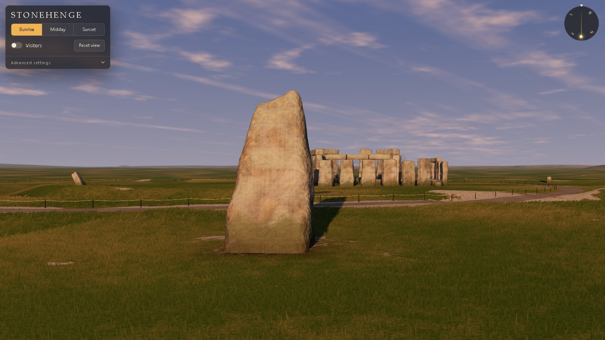
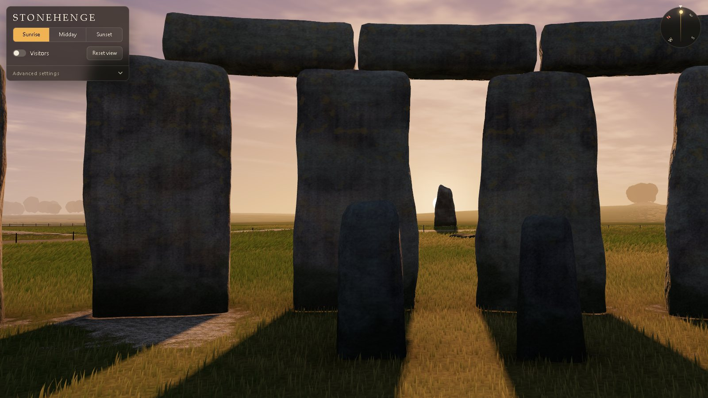
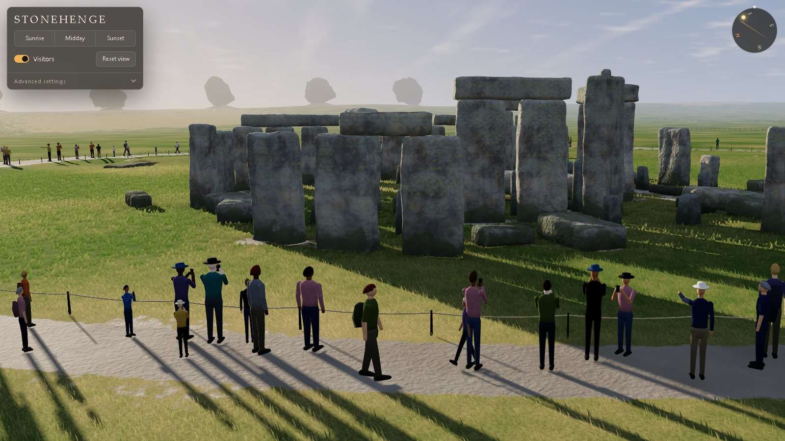
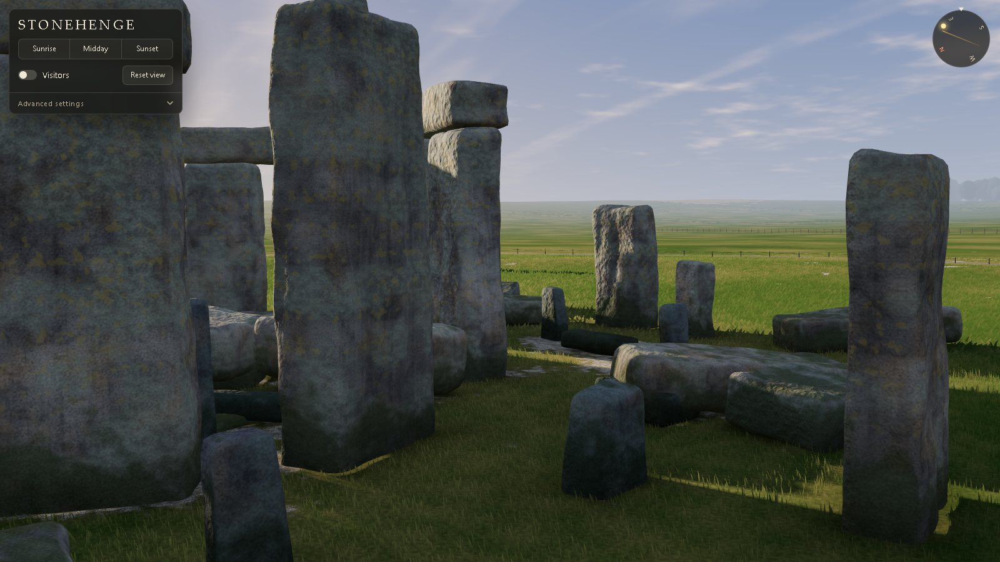
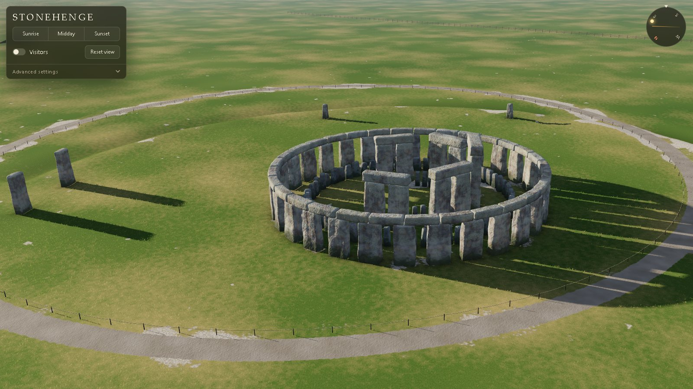

# Stonehenge Solstice

An interactive 3D model of Stonehenge that runs in the browser. Move the sun, walk the camera around the stones, and see how the monument lines up with the midsummer sunrise.

**Live scene: https://meltthemanual.github.io/stonehenge-solstice/**

## What you can do

The panel has three simple controls:

- **Sunrise / Midday / Sunset** sets the sun for 21 June, the summer solstice.
- **Visitors** adds a crowd on the visitor path.
- **Reset view** returns to the Avenue, on the main axis of the monument.

**Advanced settings** opens the rest:

- Sun azimuth and elevation sliders. The sun can follow its real path for 21 June at the latitude of Stonehenge, or move freely.
- Grass wind.
- Compass and alignment lines on the ground.
- Monument state: **Today** (the ruin) or **As built** (a reconstruction).
- Camera views: Centre, Aerial, and Plan.

Camera controls:

| Action | Mouse | Touch | Keys |
| --- | --- | --- | --- |
| Orbit | Drag | One finger | Q / E |
| Pan | Right-drag or Shift-drag | Two fingers | W A S D or arrows |
| Zoom | Wheel | Pinch | + / - |
| Focus on a point | Double-click | | |
| Reset view | | | R |
| Hide the panel | | | H |

## Pictures

| | |
| --- | --- |
|  |  |
|  |  |

## How to run it

Open the live link above. Or download `index.html` and open it in a current desktop browser. It is tested in Chrome.

The scene is one HTML file. It loads [three.js](https://threejs.org/) r160 from the jsDelivr CDN, so it needs an internet connection. It needs no build step and no server.

## How it is made

- **Stones:** Each stone is a unique mesh. A rounded block gets a taper, a wandering outline, and layers of noise, then a shader adds grain, lichen, and moss. No image files are used.
- **Ground:** Procedural turf with chalk patches, the bank and ditch, the Avenue, and the visitor path.
- **Grass:** Instanced blades in two rings around the camera. The density changes with the camera height.
- **Sun and sky:** The sun position comes from the solar declination for the June solstice and the latitude of Stonehenge (51.179° N). The sky, haze, and light colour change with the sun elevation.
- **Shadows:** One 4096-pixel shadow map fitted to the monument, with crisp edges near each object.
- **Visitors:** Low-poly instanced figures with different builds, clothes, and poses. Some of them walk.
- **Frame rate:** A governor lowers the grass density, then the pixel ratio, if the frame rate drops below 55 fps.

## Accuracy

- The sarsen circle, the trilithons, and the six lintels that are in place today follow the published stone numbers.
- The main axis points to azimuth 49.9°, the direction of the midsummer sunrise.
- The positions of the fallen stones, the bluestones, the visitor path, and the distant barrows are approximate.
- "As built" is a reconstruction. Parts of it are conjecture.
- For a clear picture, a shadow is never longer than about six times the height of its object. Real shadows at sunrise are much longer.

Sources for the stone layout:

- [The Stones of Stonehenge](http://www.stonesofstonehenge.org.uk/p/about-this-site.html)
- [Sarsen.org: How many stones are there at Stonehenge?](https://www.sarsen.org/2013/03/how-many-stones-are-there-at-stonehenge.html)
- [Nash et al. 2020, Origins of the sarsen megaliths at Stonehenge, Science Advances](https://www.science.org/doi/10.1126/sciadv.abc0133)

## License

[MIT](LICENSE)
